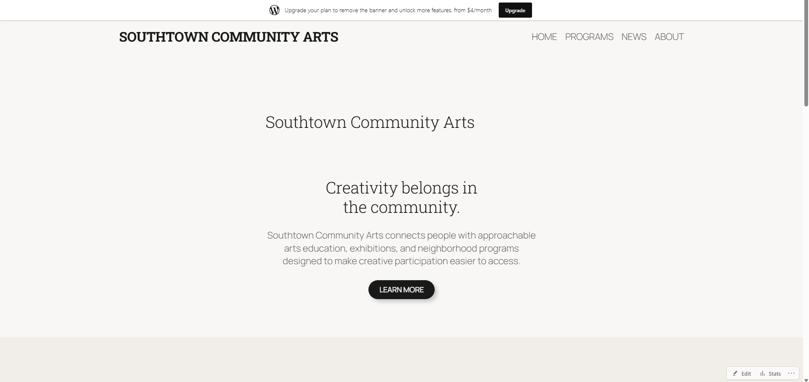
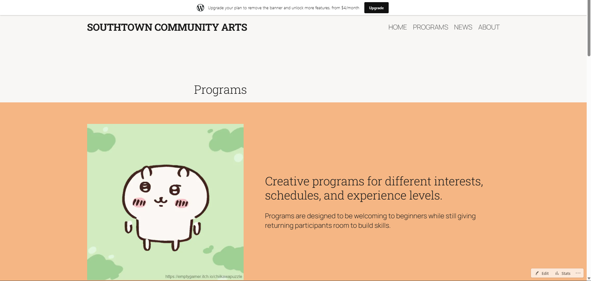
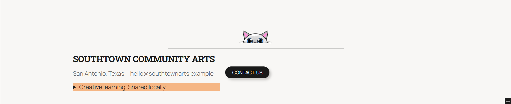
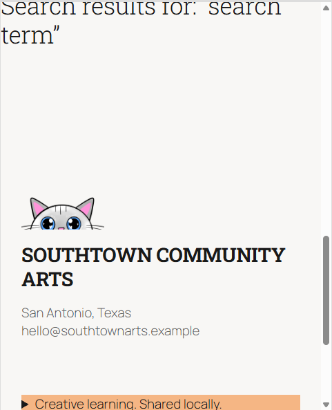
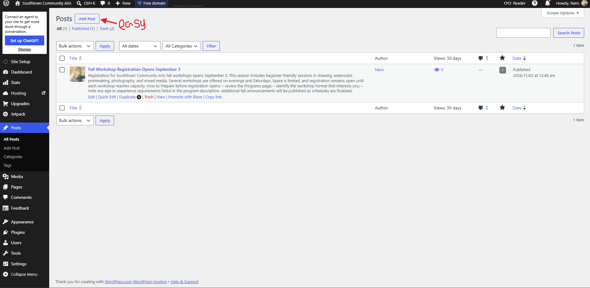

# Week 12: Customize the Experience — WordPress Development

**Client:** Southtown Community Arts  
**Role:** Junior WordPress Developer

## Project Overview

I customized the existing Week 11 CMS by applying the Southtown brand system at the global level, while leaving routine content editable and easy for the client to maintain. The site keeps its original structure and messaging, but now feels more cohesive, warm, and community-focused through consistent typography, color, navigation, and reusable patterns.

---

# Customization Decisions

Document the four required decisions below.

## 1. Global Design System

**Requirement:**  
The site-wide requirements were the approved Southtown palette, typography hierarchy, button/link treatment, spacing rhythm, and content width decisions across the whole site.

**Location:**  
[Global Styles / theme-level controls]
Also I couldn't get pass the paywall to make the page look excatly how i wanted so i compermised. And this is what I would've done if I could.

**Change:**  
I updated the overall design system to use Southtown Deep for headings and strong text, Southtown Teal as the primary brand accent, Southtown Warm sparingly for highlights and CTA emphasis, and Southtown Soft/Paper as the supporting surfaces. I also adjusted heading and body typography treatments, spacing consistency, and button/link styling so the design felt cohesive across the site.

**Why this level:**  
This requirement belongs at the global level because it affects every page and creates a consistent visual system without forcing page-by-page edits. Using theme controls keeps the brand coherent and reduces the chance that future edits drift away from the approved style.

**QA:**  
I tested the palette, contrast, spacing, and button treatments on the home and programs pages and checked the mobile layout to confirm the system still read clearly at smaller widths.

---

## 2. Branded Reusable Pattern

**Pattern:**  
Contact
**Change:**  
I created a reusable pattern that is a contact us block. It has the logo and info like the footer in the main page, but this has a button to email then and now.

**Reuse:**  
I reused the pattern on the home and programs sections to verify it remained flexible while keeping the same system treatment.

**Editor value:**  
This helps a future editor update the text, image, or CTA in place without rebuilding the layout or redoing the design. The structure stays stable, but the content remains easy to swap out.

---

## 3. Site-Wide Structure Customization

**Shared area:**  
Header and primary navigation

**Change:**  
I customized the shared site navigation to better reflect the Southtown brand by using the dark deep navy as the structural base, making the primary links more readable, and styling the main CTA/button treatment to match the brand accents. I also adjusted spacing and hierarchy so the navigation felt more contemporary and welcoming without becoming visually heavy.

**Why this level:**  
This change belongs in shared site structure because navigation appears across the site and should behave as one coherent system. A page-specific workaround would create inconsistency and make the layout harder to maintain.

**QA:**  
I checked the header and navigation on the home page, programs page, and mobile view to confirm the brand system remained consistent and the menu remained easy to use.

---

## 4. Controlled Development-Level Modification

Complete **one** option.

**Option used:**  
Targeted CSS

**Location:**  
[Where the modification lives in the supplied environment.]

**Code / configuration snippet:**

```css
.wp-block-button__link,
.wp-element-button {
  background: var(--wp--preset--color--southtown-teal);
  color: #ffffff;
  border-radius: 999px;
  transition: background-color 0.2s ease, transform 0.2s ease;
}

.wp-block-button__link:hover,
.wp-element-button:hover,
.wp-block-button__link:focus-visible,
.wp-element-button:focus-visible {
  background: #17313f;
  transform: translateY(-1px);
}
```

**Reason:**  
The built-in editor controls could set the button colors and typography, but they did not give enough control over the hover and focus states to keep the interaction clearly visible and accessible. The small CSS rule solved that without creating a custom theme or code-heavy structure.

**Documentation:**  
WordPress Theme JSON and Global Styles documentation: https://developer.wordpress.org/block-editor/how-to-guides/themes/theme-json/

**QA:**  
I checked the hover and focus states in the browser and confirmed the buttons remained readable, visible, and consistent on both desktop and mobile layouts without creating visual conflicts elsewhere.

---

# Visitor + Editor QA

## Visitor Experience

- [x] I tested narrow and wide viewport behavior.
- [x] I checked visual consistency on more than one page.
- [x] I checked text/link/button contrast.
- [x] I verified visible keyboard focus.
- [x] I tested navigation and links.
- [x] I checked that the brand system is consistent rather than page-specific.

### Visitor QA Notes
I confirmed that the Southtown palette, navigation, and buttons remained coherent on both desktop and mobile layouts, and that hover/focus states stayed clearly visible without sacrificing readability.

## Editor Experience

- [x] Routine content is still editable through WordPress.
- [x] The branded pattern is understandable to reuse/edit.
- [x] My customization did not move ordinary client content into code.
- [x] I performed one temporary routine content edit, previewed it, and restored the original content.
- [x] The site remained visually coherent after the editor test.

### Editor QA Notes
I temporarily updated CTA text within the reusable branded pattern, previewed the change, and verified that the design stayed intact and the pattern remained easy to edit. After restoring the original copy, the layout still looked consistent and professional.

---

# Evidence
This is what I did to try and fit it to what it had wanted.
Use the exact filenames below.

## Customized Home



## Customized Programs



## Branded Reusable Pattern



## Responsive / Mobile View



## Editor Maintainability Test



---

# Maintainability Reflection

Write approximately **75–100 words** responding to:

> Give one example of a change you intentionally handled globally and one change you intentionally left as editable content. How does that separation help Southtown Community Arts maintain the site without losing design consistency?

I intentionally handled the Southtown color system, typography, and button treatment globally so the whole site would feel unified without needing page-by-page styling. I left the actual program, event, and article content as editable WordPress content so the client can update messaging and information without code. This separation helps Southtown Community Arts maintain a polished, recognizable brand while still giving staff flexibility to update their content regularly. It keeps the design consistent without making routine edits harder or more fragile.

---

# Final Handoff Check

- [x] I continued the Week 11 Southtown site rather than rebuilding it.
- [x] I applied the approved palette and typography direction systematically.
- [x] I used global controls for global decisions.
- [x] I created or significantly customized one branded reusable pattern.
- [x] I made one appropriate site-wide structure customization.
- [x] I completed exactly one controlled development-level modification.
- [x] I did not add PHP, plugins, custom blocks, or a child-theme build for this assignment.
- [x] Visitor and editor QA are complete.
- [x] All five evidence screenshots display in this README.
- [x] I completed the maintainability reflection.
- [x] I committed and pushed the Week 12 handoff folder.
