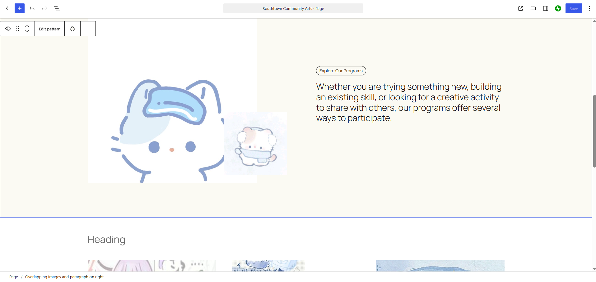
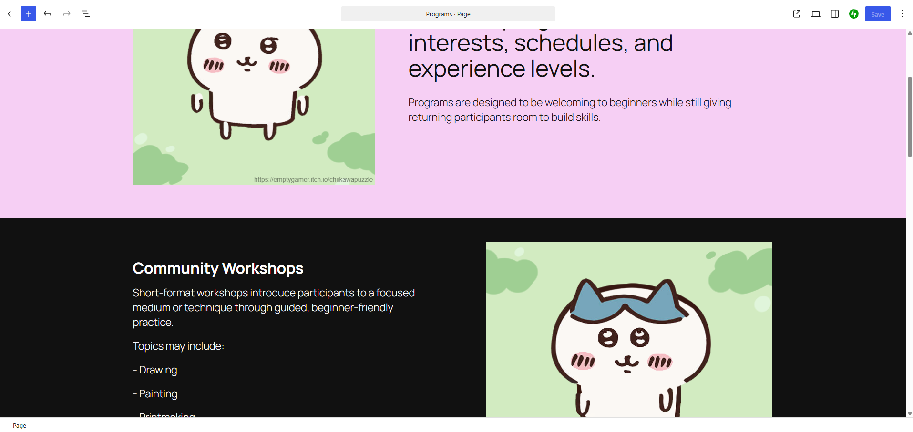
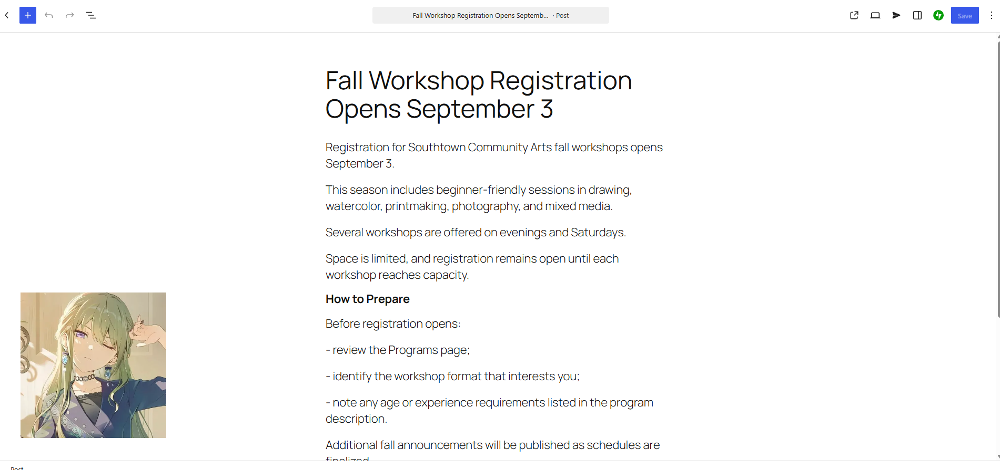
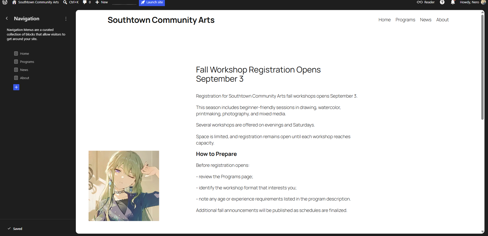
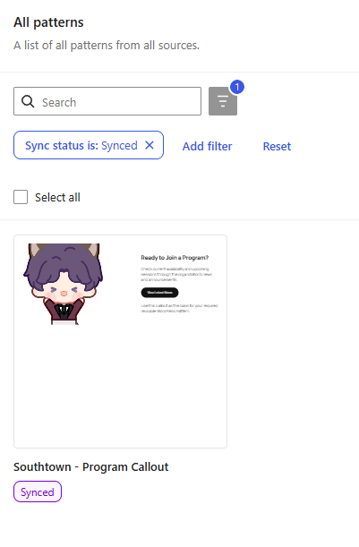
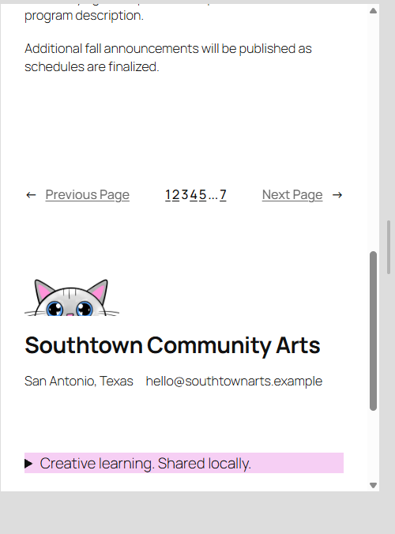

# Week 11: Build for Content — WordPress & CMS Fundamentals

## CMS Project Overview

**Client:** Southtown Community Arts  
**Role:** Junior Web / CMS Specialist  
**Week:** 11 — Build for Content: WordPress & CMS Fundamentals

Briefly summarize what you configured in WordPress.

[Write 2–3 sentences here.]

---

## WordPress Site Access

**Site URL or instructor-access information:**  
[\[Add the site URL or access information provided by your instructor.\]](https://vmedllin17.wordpress.com/)

---

# Content Architecture

I put everyting in a thier own box and groups

## Pages

List the Pages you created and briefly explain why they belong as Pages.

- **Home:** [The home page where the info about there servis]
- **Programs:** [A page about their programs]
- **About:** [A page that explain what they belevie in foing.]

## Post

**News Post:** [Fall Workshop Registration Opens September 3]

Explain why this content belongs as a Post rather than a Page.

[This post is an event thats coming up soon and only temparay then keeping forever.]

---

# Reusable Pattern

**Pattern Name:**  
[Ready to Join a Program?]

**Used For:**  
[Check current availability and upcoming sessions through the organization’s news and announcements.]

**Why a Pattern Was Appropriate:**  
[if they make any more pages they can add this block to easyliy go to the posts to keep up to date.]

---

# Site-Wide Structure

Describe the required Site Editor change you completed.

**Change:**  
[I didn't change anything because I made it....]

**Where It Was Made:**  
[Header, footer, navigation, template part, etc.] all?

**Why It Belongs at the Site Level:**  
[Explain why this should affect multiple pages rather than one page only.] You want something stable so that cunsumers know how to navigate somewhere without always trying to find something new.

---

# Client Update Test

Complete `CLIENT-UPDATE.md` after the primary site build, then document the result here.

## Supplied Update

Briefly identify the client change you completed.

They wanted a paragrph change a bit to be more spific

## Where I Made the Update

What WordPress content-editing area did you use?

In the programs page i change what they wanteed. > Short-format workshops introduce participants to a specific medium or technique.
to > Short-format workshops introduce participants to a focused medium or technique through guided, beginner-friendly practice.

## Structure Check

Did you need to modify the header, footer, navigation, template, template part, or reusable pattern? Explain.

I made the hearder more easly to read like home instead of Southtown Community Arts

## Maintainability Result

Explain how this update demonstrates that routine content can change without rebuilding the site's global structure.

Adding a smiple edit dosen't need to be looking everywhere. Its not messy as ii is in scripting (for someone who dosen't know it).

---

# Accessibility & Responsive Checks

Document the quality checks you completed.

## Headings

I made sure that the nav was in the order they wanted

## Images
I added all drawing to the images and made sure to add detail descrpion for them.

## Links & Buttons

I would pressed enter and click a black square to add something.

## Keyboard

[Briefly explain how you tested keyboard navigation and visible focus.]
im not too sure

## Responsive Layout

(I check with there own preview of how the ipad and phone would look like.)

---

# Evidence

Replace the files in the `evidence/` folder with your own screenshots using the exact required filenames.

## Home Page

## Programs Page

## News Post

## Primary Navigation

## Reusable Pattern

## Narrow-Screen / Mobile View

---

# Developer Handoff

Keep each response concise and specific to this project.

## CMS Choice

Why is WordPress an appropriate solution for Southtown Community Arts?

It is very easy to add blocks and make it fast. It also can help out the owner so they can update it whenever.

## Editable Content

What information should Southtown Community Arts staff be able to update routinely?

They can add post regulaty. adding another page is also very easy.

## Reusable Structure

What site element did you make reusable or site-wide, and why?

I made a block that will take you to the post fast. Also having a footer across is very easy for the user to contact the place.

## Client Protection

What design or architecture decision helps the site remain consistent when staff members make routine updates?

having a color theme will help them stay in the color group. and having a set and stone page can help them recreate it/ use it again.

---

# Final Handoff Check

- [ ] Home, Programs, and About are published as Pages.
- [ ] The supplied announcement is published as a Post.
- [ ] Primary navigation works in the required order.
- [ ] One meaningful reusable Pattern is present.
- [ ] The required site-wide structure adjustment is complete.
- [ ] I completed the supplied `CLIENT-UPDATE.md` request after the main build.
- [ ] The client update did not require unnecessary global-structure changes.
- [ ] Headings are logical.
- [ ] Informative images have meaningful alternative text.
- [ ] Link and button labels are understandable.
- [ ] Keyboard focus is visible.
- [ ] Narrow-screen behavior was checked.
- [ ] All six evidence images display correctly in this README.
- [ ] All four Developer Handoff responses are complete.
- [ ] I committed and pushed this Week 11 handoff folder.
